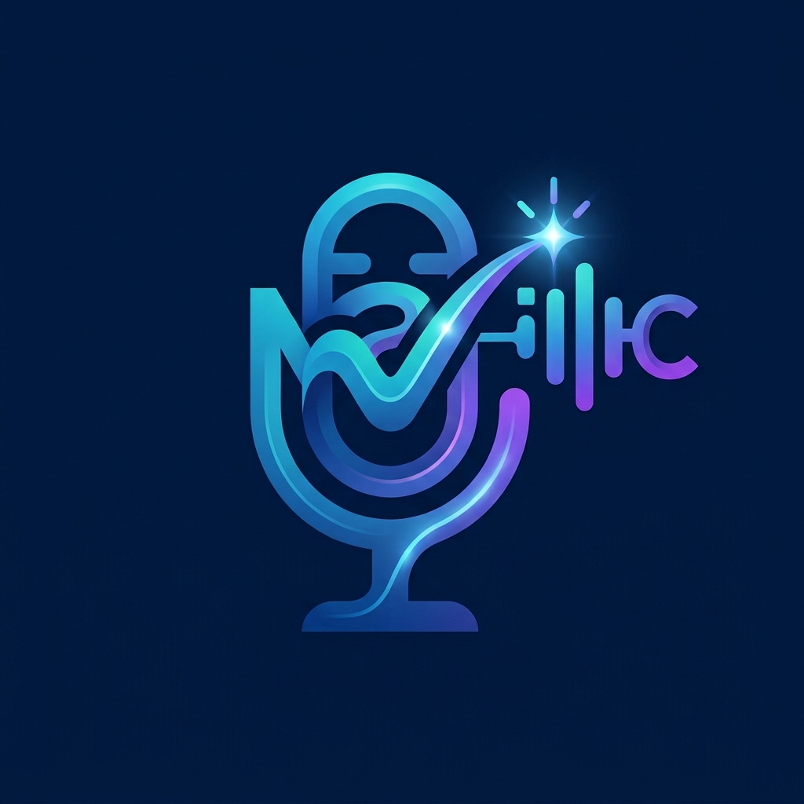

<p align="center">
  
</p>

# mAIcrophone

[](https://github.com/elmuz/mAIcrophone/actions/workflows/ci.yml)
[](https://github.com/astral-sh/uv)
[](https://github.com/astral-sh/ruff)
[](https://github.com/astral-sh/ty)

Local, focusless push-to-talk dictation for Niri/Wayland, backed by
`nemo-speech serve` and the Nemotron 3.5 streaming ASR model.

mAIcrophone runs as a small background daemon. A global shortcut starts and
stops recording; live text appears in an overlay that never steals keyboard
focus, and the final transcript is typed into the window that was focused when
recording started.

**Status:** first vertical slice. The core recording → ASR → overlay → injection
flow works end to end. Missing features are tracked in
[docs/backlog.md](docs/backlog.md).

## Main features

- **Focusless overlay** on the focused Niri output. The editor or prompt keeps
  keyboard focus while partial and final transcripts are displayed.
- **Streaming local ASR** through a separate `nemo-speech` WebSocket server,
  with live partials and an authoritative final transcript.
- **Pluggable backends** for compositor, audio capture, text injection, ASR,
  and overlay. Batch ASR servers such as whisper.cpp and OpenAI-compatible
  endpoints are also supported.
- **Per-session language switching** (`en-US`, `it-IT`, `auto`, …) from the CLI.
- **Safe text injection** with `wtype`: the original target window is restored
  if focus moved during dictation, and the transcript can also be copied to the
  clipboard and PRIMARY selection.
- **Local-first**: audio and transcripts stay on the machine unless you
  explicitly configure a remote ASR endpoint.

## Getting started

### 1. Install the runtime dependencies

Required on Arch Linux / Wayland / Niri:

- Python 3.11+
- `wtype`
- `libwayland-client`
- `libpulse` and a PulseAudio-compatible server (usually `pipewire-pulse`)
- `nemo-speech` with the `nemotron-3.5` model

The GTK4 overlay is optional:

```bash
sudo pacman -S --needed gtk4 gtk4-layer-shell python-gobject python-cairo
```

See [docs/development.md](docs/development.md) for a complete setup, including
the ASR server and the optional ITN grammars.

### 2. Install mAIcrophone

```bash
python -m venv --system-site-packages .venv
. .venv/bin/activate
pip install -e .
```

For the overlay, install the Python extra:

```bash
pip install -e '.[overlay]'
```

### 3. Configure and run

```bash
cp config/config.toml ~/.config/maic/config.toml
nemo-speech serve --asr-model nemotron-3.5 --host 127.0.0.1 --port 8080
maic daemon
```

In another shell:

```bash
maic toggle     # start recording; call again to stop and type
maic cancel     # discard the current recording
maic status     # show daemon state
```

Add the shortcuts to your Niri configuration:

```kdl
Mod+Alt+V       { spawn "maic" "toggle"; }
Mod+Alt+Shift+V { spawn "maic" "cancel"; }
```

For systemd user services, headless operation, overlay launching, and all
configuration options, see [docs/configuration.md](docs/configuration.md).

## Documentation

| Document | Contents |
| --- | --- |
| [Architecture](docs/architecture.md) | Process model, session state machine, ASR transport, backends, overlay, injection, and design decisions. |
| [Development](docs/development.md) | Repository layout, local setup, running tests, backend development, debugging, and libraries used. |
| [Configuration](docs/configuration.md) | Config file reference, backends, services, Niri bindings, and troubleshooting. |
| [Contributing](docs/contributing.md) | Workflow, coding conventions, testing expectations, and good first contributions. |
| [IPC protocol](docs/ipc.md) | Versioned daemon/CLI Unix-socket protocol. |
| [Roadmap](docs/roadmap.md) | Architectural sequence and decision gates. |
| [Backlog](docs/backlog.md) | User-facing features, known gaps, and explicitly skipped work. |

## Current limitations

- Niri only.
- The overlay does not accept input; language and cancel actions are global
  shortcuts.
- The overlay caps its height, auto-scrolls long transcripts, and has no manual
  scrolling.
- No endpointing, transcript history, or spoken/manual punctuation yet.
- Partial text is best-effort; the final transcript is authoritative.

## License

No license has been chosen yet. Treat the repository as all rights reserved
until a license is added.
